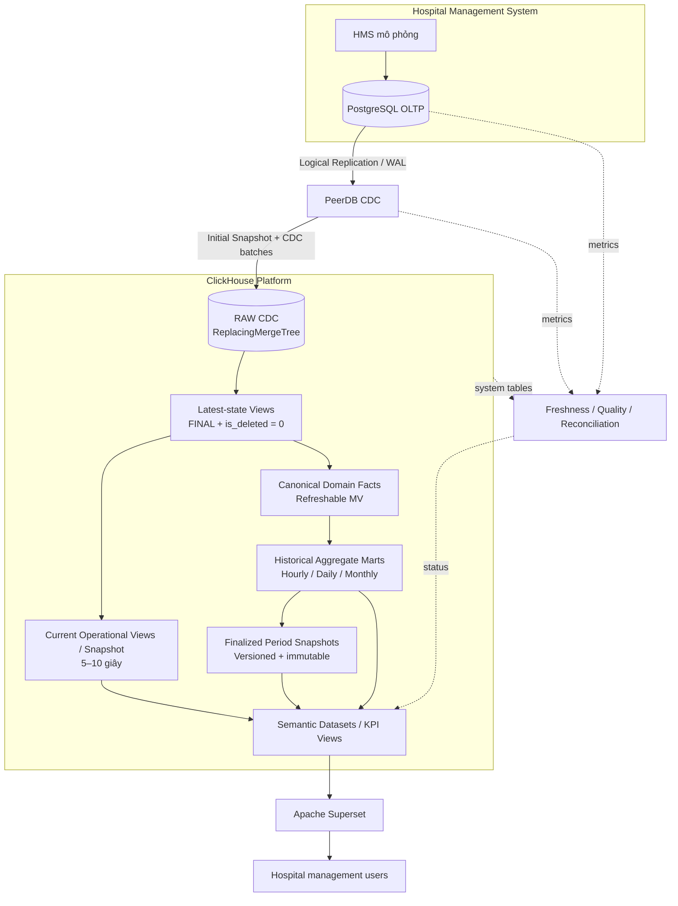
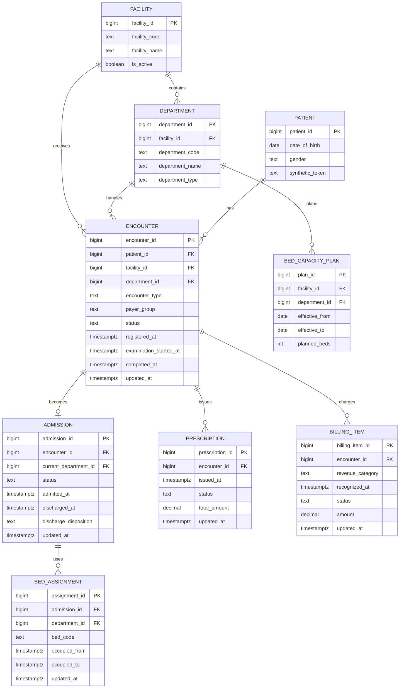
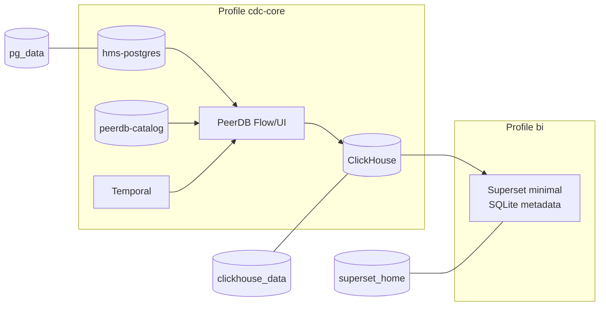

# Thiết kế kiến trúc Hospital Analytics Platform và lab đánh giá

**Trạng thái:** Bản thiết kế đề xuất, chờ phê duyệt trước khi triển khai  
**Ngày:** 2026-10-26  
**Phạm vi dashboard:** `docs/metric.md` và ảnh `docs/image/photo_2026-10-10_11-08-12.jpg`

## 1. Tóm tắt quyết định

Thiết kế dùng một pipeline chính:

**PostgreSQL → PostgreSQL Logical Replication → PeerDB → ClickHouse → Superset**.

Lab chạy bằng Docker Compose trên máy tối đa 16 GB RAM. Full stack có thể chạy đồng thời cho smoke test/end-to-end development; các profile vẫn được giữ để debug hoặc giảm tài nguyên khi cần. Source HMS là schema mô phỏng và dữ liệu synthetic để test trước; khi có thông tin PostgreSQL ngoài, PeerDB sẽ chuyển sang kết nối đó mà không đổi các ClickHouse data layers. ClickHouse chạy single-node production-shaped. Superset là BI duy nhất trong lab đầu tiên.

Nguyên tắc quan trọng nhất là **đúng dữ liệu trước, nhanh sau**:

- PeerDB ghi UPDATE và DELETE vào ClickHouse dưới dạng các version mới.
- RAW dùng `ReplacingMergeTree(_peerdb_version)` và giữ `_peerdb_is_deleted`.
- Truy vấn latest state phải dùng `FINAL` và loại bản ghi đã xóa, hoặc đọc bảng đã được Refreshable Materialized View khử trùng lặp.
- Không aggregate trực tiếp bằng Incremental Materialized View từ bảng CDC mutable, vì MV không tự đảo số liệu của version cũ khi có UPDATE/DELETE.
- Dữ liệu operational của ngày hiện tại lấy từ latest state; dữ liệu lịch sử dùng Refreshable Materialized View và aggregate mart.

## 2. Mục tiêu, ngoài phạm vi và tiêu chí thành công

### 2.1 Mục tiêu

1. Dựng được đầy đủ dashboard trong `docs/metric.md`.
2. Kiểm chứng initial snapshot và CDC cho INSERT, UPDATE, DELETE, duplicate và out-of-order delivery.
3. Hỗ trợ bộ lọc thời gian, cơ sở, khoa/phòng, đối tượng, giới tính và nhóm tuổi.
4. Hỗ trợ current period, previous period và phần trăm biến động.
5. Chứng minh kiến trúc hybrid: operational gần real-time và historical refresh định kỳ.
6. Đo freshness, correctness, query latency và khả năng recovery.
7. Tạo nền thiết kế có thể nâng cấp lên production mà không đổi nguyên tắc dữ liệu.

### 2.2 Ngoài phạm vi lab đầu tiên

- Dữ liệu bệnh nhân thật hoặc tích hợp trực tiếp HMS thật.
- ClickHouse cluster, replication, ClickHouse Keeper, HA và disaster recovery đa vùng.
- Kubernetes, Kafka, Spark, Flink, Airflow hoặc dbt.
- Grafana; chỉ bổ sung sau nếu cần dashboard hạ tầng riêng.
- Load test ở quy mô production.
- Các dashboard chuyên khoa ngoài màn hình tổng quan; schema vẫn chừa đường mở rộng hợp lý nhưng không dựng trước tính năng chưa được yêu cầu.

### 2.3 Tiêu chí thành công của lab

| Nhóm | Tiêu chí |
|---|---|
| Dashboard | Có đủ 8 KPI, 5 khu vực phân tích, cảnh báo và toàn bộ filter hợp lệ |
| Correctness | Bộ test có expected result khớp cho INSERT/UPDATE/DELETE, điều chỉnh hồi tố và late arrival |
| CDC freshness | Khi chạy profile CDC riêng, p95 từ commit PostgreSQL đến RAW ClickHouse không quá 5 giây trong tải lab |
| Dashboard freshness | Operational dashboard hiển thị dữ liệu mới trong khoảng 5–10 giây; historical theo lịch refresh |
| Query latency | p95 truy vấn widget dưới 2 giây trên dữ liệu lab sau warm-up |
| Recovery | Dừng và chạy lại PeerDB không mất dữ liệu khi WAL vẫn còn |
| Reconciliation | Count, amount và checksum theo ngày giữa PostgreSQL và ClickHouse khớp với bộ dữ liệu kiểm thử |
| Tài nguyên | Full profile có ngân sách Docker 12–16 GB; profile nhỏ là fallback khi tài nguyên thấp hơn |

## 3. Kiến trúc tổng thể



### 3.1 Luồng dữ liệu end-to-end

1. HMS ghi giao dịch vào PostgreSQL.
2. PostgreSQL WAL giữ thay đổi theo commit order; PeerDB đọc qua replication slot.
3. Lần đầu, PeerDB thực hiện consistent initial snapshot, sau đó tiếp tục CDC từ vị trí WAL tương ứng.
4. PeerDB đưa bản ghi vào ClickHouse cùng `_peerdb_version`, `_peerdb_is_deleted` và `_peerdb_synced_at`.
5. RAW giữ các version vật lý; background merge chỉ dọn version cũ theo thời gian.
6. Latest-state views tạo ảnh logic đúng tại thời điểm query bằng `FINAL` và loại tombstone.
7. Current operational layer tính trạng thái ngày hiện tại hoặc các workflow đang active.
8. Refreshable Materialized Views định kỳ tạo canonical facts và historical aggregates từ latest state.
9. Semantic layer cung cấp dataset ổn định cho Superset; BI không đọc RAW trực tiếp.
10. Freshness watermark hiển thị “Thời gian cập nhật” trên dashboard.

## 4. Công nghệ và lý do lựa chọn

| Thành phần | Lựa chọn | Lý do | Giới hạn cần biết |
|---|---|---|---|
| OLTP | PostgreSQL | Mô phỏng đúng HMS nguồn và hỗ trợ logical replication tốt | Replication slot có thể giữ WAL làm đầy disk |
| CDC | PeerDB | Native PostgreSQL CDC, initial snapshot, soft delete, ClickHouse sink | Self-hosted PeerDB có Flow, Temporal và catalog PostgreSQL; cần budget RAM đáng kể |
| Analytics | ClickHouse | Scan, aggregation, compression và dashboard latency tốt | Mutable CDC cần latest-state logic rõ ràng |
| Transformation | ClickHouse SQL | Ít thành phần vận hành, đủ cho lab và phần lớn use case | Partition-level rebuild phức tạp có thể cần scheduler khi quy mô lớn |
| Current state | `ReplacingMergeTree` + `FINAL` | Xử lý version CDC đúng và đơn giản | Background merge không đảm bảo query luôn deduplicated |
| Historical | Refreshable MV | Recompute đúng khi có correction, JOIN và DELETE | Refresh toàn bộ query; phải benchmark khi dữ liệu lớn |
| BI | Superset | Phù hợp filter, chart, table và period comparison | Cần quản lý cache/freshness; cấu hình tối giản trong lab |

Không chọn Kafka, Spark hoặc Flink ở giai đoạn này vì chỉ có một nguồn, một sink, tải lab và chưa có yêu cầu fan-out/replay độc lập.

## 5. HMS source schema mô phỏng

Schema chỉ bao gồm dữ liệu cần để chứng minh dashboard. Mọi bảng CDC đều có primary key; `updated_at` phục vụ kiểm thử và quan sát, không thay thế `_peerdb_version`.



### 5.1 Quy ước source

- `encounter_type`: `OPD`, `IPD`, `ED`.
- `payer_group`: `BHYT`, `SERVICE`, `REQUEST`, `CHECKUP`, `OTHER`.
- Encounter statuses tối thiểu: `WAITING`, `IN_PROGRESS`, `COMPLETED`, `CANCELLED`.
- Admission statuses tối thiểu: `PENDING_CONFIRMATION`, `ADMITTED`, `DISCHARGED`, `CANCELLED`.
- `discharge_disposition`: `HOME`, `TRANSFER`, `DEATH`, `OTHER`.
- Prescription chỉ được tính khi status thuộc tập business-approved, mặc định `ISSUED` hoặc `DISPENSED`; `CANCELLED` bị loại.
- Billing item chỉ tính doanh thu khi `POSTED`; `VOID` bị loại. Số âm được dùng cho reversal hợp lệ.
- `revenue_category`: `EXAM`, `BED`, `LAB`, `IMAGING`, `PROCEDURE`, `DRUG`, `SUPPLY`.
- Nhóm tuổi được suy ra tại ngày encounter, không lưu cứng trên patient.
- `synthetic_token` chỉ là mã giả lập; production phải pseudonymize trước khi cấp quyền analytical.
- `current_department_id` của admission phục vụ trạng thái hiện tại; lịch sử chuyển khoa được suy ra từ các khoảng `BED_ASSIGNMENT`.
- Nhóm tuổi mặc định của lab: `0–5`, `6–15`, `16–39`, `40–59`, `60+`, và `UNKNOWN`.
- Department của OPD/ED, đơn thuốc và doanh thu mặc định lấy từ encounter. Bed-day dùng department của bed assignment. Production phải xác nhận lại quy tắc attribution.

### 5.2 Dữ liệu synthetic

Dữ liệu lab dự kiến gồm 6–12 tháng, nhiều cơ sở, khoảng 10–20 khoa và tối đa vài trăm nghìn nghiệp vụ. Generator phải tạo được:

- Luồng trạng thái bình thường và bị hủy.
- UPDATE đổi status, khoa, payer, amount và ngày nghiệp vụ.
- Hard DELETE để kiểm tra tombstone.
- Late arrival và correction vào kỳ cũ.
- Duplicate/retry ở phía CDC.
- Bed assignment qua nửa đêm và qua tháng.
- Reversal doanh thu và đơn thuốc bị hủy.

## 6. Kiến trúc dữ liệu ClickHouse

Đề xuất dùng năm database logic:

| Database | Vai trò |
|---|---|
| `hms_raw` | Bảng do PeerDB đồng bộ, giữ CDC metadata |
| `hms_core` | Latest-state views và canonical domain facts |
| `hms_mart` | Current snapshot, daily/monthly aggregate, finalized snapshot |
| `hms_semantic` | Dataset thân thiện với Superset, metric contract |
| `hms_ops` | Freshness, data quality và reconciliation result |

### 6.1 Layer 1 — RAW / CDC

Mẫu logic của một bảng RAW:

```sql
ENGINE = ReplacingMergeTree(_peerdb_version)
ORDER BY (<postgres_primary_key>)
```

PeerDB bổ sung:

- `_peerdb_version`: version tăng theo CDC ordering.
- `_peerdb_is_deleted`: tombstone của DELETE khi bật soft delete.
- `_peerdb_synced_at`: thời điểm bản ghi được đưa tới ClickHouse.

Quy tắc bắt buộc:

1. `ORDER BY` RAW phải giữ PostgreSQL primary key làm deduplication key.
2. Không thêm cột mutable như status, department hoặc event date vào dedupe key.
3. Lab không partition RAW để tránh cùng primary key rơi vào hai partition khi ngày bị sửa.
4. Production chỉ partition RAW theo cột bất biến đã được chứng minh; nếu không, ưu tiên đúng dữ liệu hơn pruning.
5. Không chạy `OPTIMIZE ... FINAL` thường xuyên như một cơ chế correctness.

Latest-state view:

```sql
CREATE VIEW hms_core.encounter_latest AS
SELECT *
FROM hms_raw.encounter FINAL
WHERE _peerdb_is_deleted = 0;
```

`FINAL` là yêu cầu correctness, không phải tuning tùy chọn. Với query lớn, dữ liệu sẽ được materialize định kỳ sang core/mart để BI không phải dùng `FINAL` trên RAW.

### 6.2 PostgreSQL UPDATE/DELETE được biểu diễn thế nào

| PostgreSQL | ClickHouse vật lý | Kết quả logic |
|---|---|---|
| INSERT | Thêm row version đầu tiên | Row xuất hiện |
| UPDATE | Thêm row cùng PK, version lớn hơn | Version mới thắng |
| DELETE | Thêm tombstone cùng PK, version lớn hơn, `is_deleted=1` | Row bị loại khỏi latest state |
| Retry/duplicate | Có thể thêm lại version | `FINAL`/ReplacingMergeTree giữ version thắng |
| Out-of-order | Version cũ có thể đến sau | Max `_peerdb_version` vẫn thắng |

Background merge diễn ra bất định. Vì vậy `SELECT count(*) FROM hms_raw.encounter` không phải số encounter hiện tại và không được dùng làm KPI.

### 6.3 Layer 2 — Transformation

Transformation có hai nhánh:

#### Current operational

- Normal views trên latest state cho workflow đang active và dữ liệu ngày hiện tại.
- Có thể tạo một current snapshot nhỏ refresh mỗi 5–10 giây để Superset đọc nhanh.
- Chỉ scan active/current-day subset; không full-refresh toàn bộ lịch sử sau mỗi 5 giây.
- Với quy mô lab, query trực tiếp latest-state view là baseline correctness để so sánh current snapshot.

#### Historical canonical facts

Refreshable Materialized Views tạo các fact đã denormalize:

- `fact_encounter`
- `fact_admission`
- `fact_bed_day`
- `fact_prescription`
- `fact_revenue_line`

Mỗi lần refresh đọc latest state, do đó correction, DELETE và dimension update đều được phản ánh. Với lab, full recompute trong ClickHouse là lựa chọn đơn giản nhất; đây không phải reload PostgreSQL.

### 6.4 Layer 3 — Data mart và semantic

Data mart lưu số đo ở grain rõ ràng, không chỉ lưu tỷ lệ cuối. Ví dụ occupancy phải giữ cả `occupied_bed_days` và `planned_bed_days`; average length of stay giữ `treatment_days` và `discharge_count`. Cách này cho phép aggregate đúng qua nhiều ngày/khoa.

Semantic views đặt tên metric ổn định, chuẩn hóa filter columns và che hoàn toàn CDC metadata khỏi Superset.

## 7. Chiến lược Materialized View

| Loại | Dùng cho | Không dùng cho |
|---|---|---|
| Normal view + `FINAL` | Baseline latest state, query operational hẹp | Dashboard lịch sử scan rộng |
| Incremental MV | Append-only event thật sự, technical metric, aggregate không bao giờ cần reverse | Trực tiếp aggregate bảng PeerDB mutable |
| Refreshable MV | Deduplication, JOIN nhiều bảng, correction, daily/monthly mart | Full refresh rất lớn với chu kỳ vài giây |
| Refreshable MV `APPEND` | Finalized snapshot có `snapshot_at`/`version` | Current state cần thay thế kết quả cũ |

### 7.1 Vì sao không aggregate CDC bằng Incremental MV

Incremental MV chỉ chạy trên block vừa INSERT. Khi encounter đổi từ `WAITING` sang `COMPLETED`, ClickHouse nhận thêm version `COMPLETED`; MV không tự trừ version `WAITING`. Tương tự, DELETE không tự đảo count hoặc sum đã ghi. Kết quả sẽ tăng trùng.

Chỉ dùng incremental aggregation nếu một trong hai điều kiện đúng:

1. Source là immutable append-only; correction được mô hình bằng compensating event có dấu âm rõ ràng.
2. Pipeline tự phát ra before/after delta chính xác và aggregate target dùng signed values.

Hai điều kiện này chưa tồn tại trong HMS lab, nên Refreshable MV/latest-state là mặc định an toàn.

### 7.2 Lịch refresh đề xuất

| Dataset | Lab | Production khởi điểm | Freshness |
|---|---:|---:|---:|
| RAW CDC | PeerDB sync 1–2 giây | 1–5 giây | Gần real-time |
| Current snapshot | 5–10 giây | 5–15 giây, sau benchmark | Operational |
| Canonical facts | 1 phút | 1–5 phút | Mutable history |
| Hourly operational mart | 1 phút | 1–5 phút | Intraday trend |
| Daily marts | 5 phút | 5–15 phút | Reporting |
| Monthly marts | 1 giờ | 1–6 giờ | Long-range analytics |
| Finalized snapshot | Manual hoặc cuối ngày/tháng | Theo period close | Immutable/as-of |

Ngay cả với lab 16 GB, các refresh nặng nên dùng `OFFSET` hoặc dependencies để dàn lịch, tránh contention với CDC và dashboard.

### 7.3 Quy tắc hybrid serving

Semantic layer chia query theo ngày để tránh vừa chậm vừa count trùng:

1. Ngày hiện tại và workflow còn active đọc current snapshot/latest state.
2. Các ngày đã hoàn tất đọc hourly/daily historical mart.
3. Query kéo qua hôm nay dùng `UNION ALL`: historical với `metric_date < today()` cộng current với `metric_date = today()`.
4. Sau grace period đầu ngày, ngày hôm trước được historical refresh và trở thành nguồn duy nhất cho ngày đó.
5. Baseline query trực tiếp latest state được giữ để đối chiếu current snapshot trong test, không cấp cho BI user.

`hms_mart.operational_activity_hourly` giữ dữ liệu intraday gần đây ở grain hour × facility × department × các chiều bệnh nhân. Daily/monthly marts phục vụ khoảng thời gian dài hơn.

## 8. Thiết kế data mart

### 8.1 Conformed dimensions

| Dimension | Thuộc tính chính |
|---|---|
| `dim_date` | date, day/week/month/quarter/year, days_in_month |
| `dim_facility` | facility_id, code, name, active |
| `dim_department` | department_id, facility_id, code, name, type |
| `dim_payer_group` | BHYT, dịch vụ, yêu cầu, khám sức khỏe, khác |
| `dim_gender` | Chuẩn hóa gender code |
| `dim_age_group` | Các khoảng tuổi có hiệu lực; age tính tại service date |
| `dim_revenue_category` | Khám, giường, xét nghiệm, CĐHA, thủ thuật/phẫu thuật, thuốc, vật tư |

Dimension tên khoa/cơ sở có thể thay đổi. Lab dùng current label. Production cần quyết định SCD Type 1 hay Type 2 theo yêu cầu báo cáo “tên tại thời điểm phát sinh”.

### 8.2 Patient Operations Mart

#### `hms_core.fact_encounter`

**Grain:** một encounter latest state.  
**Dimensions:** service date/time, facility, department, encounter type, payer group, gender, age group.  
**Measures/flags:** waiting, active, completed, cancelled, wait seconds, examination seconds.

#### `hms_core.fact_admission`

**Grain:** một admission episode latest state.  
**Measures/flags:** admitted, discharged, transfer, death, treatment days, active-at-query-time.

#### `hms_mart.patient_activity_daily`

**Grain:** date × facility × department × payer × gender × age group × encounter type.  
**Measures:** encounter count, admission count, discharge count, transfer count, death count, waiting seconds, examined count.

Các distinct/non-additive metric cần đọc canonical fact hoặc lưu aggregate state; không cộng các daily distinct count nếu một admission có thể xuất hiện nhiều ngày.

### 8.3 Hospital Capacity Mart

#### `hms_core.fact_bed_day`

**Grain:** date × facility × department.  
**Measures:** planned beds, planned bed-days, occupied bed-days.  
Bed assignment qua nửa đêm được tách theo ngày bằng calendar expansion.

Mặc định lab, occupied bed-day của mỗi ngày là số giây overlap giữa assignment và ngày đó chia 86.400; vì vậy ca nằm một phần ngày tạo fractional bed-day. `occupied_beds_at_snapshot` là metric riêng, không suy ra từ bed-day. Quy tắc chính thức có thể thay bằng midnight census hoặc patient-day theo quy định bệnh viện.

#### `hms_mart.bed_occupancy_daily`

**Grain:** date × facility × department.  
**Measures:** `occupied_bed_days`, `planned_bed_days`, `occupied_beds_at_snapshot`, `available_beds_at_snapshot`.

```text
bed_occupancy_rate = sum(occupied_bed_days) / nullIf(sum(planned_bed_days), 0)
```

Không lấy trung bình cộng của tỷ lệ từng ngày/khoa.

### 8.4 Clinical Operations Mart

Trong lab dashboard tổng quan, phần clinical tối thiểu nằm trong encounter/admission. Các mart mở rộng sau khi dashboard hiện tại hoàn tất:

- `lab_order_current`: pending laboratory orders.
- `lab_turnaround_daily`: ordered-to-collected và collected-to-result duration.
- `service_utilization_daily`: lab, imaging, procedure volume.

Các bảng này **không được dựng ở phase đầu** vì `docs/metric.md` chưa yêu cầu widget tương ứng.

### 8.5 Prescription Mart

#### `hms_core.fact_prescription`

**Grain:** một prescription latest state.  
**Dimensions:** issued date, facility, department, payer, gender, age group, amount bucket.  
**Measures:** prescription count, total amount.

`amount_bucket` được suy ra từ amount cuối cùng:

- `LE_500K`: amount ≤ 500.000 VND.
- `GT_500K`: amount > 500.000 VND.

Nếu amount UPDATE từ 400.000 thành 600.000, Refreshable MV phải chuyển đúng đơn từ bucket cũ sang bucket mới.

### 8.6 Financial Mart

#### `hms_core.fact_revenue_line`

**Grain:** một billing item latest state.  
**Dimensions:** recognized date, facility, department, payer, gender, age group, revenue category.  
**Measures:** gross amount, reversal amount, net recognized amount.

#### `hms_mart.revenue_daily`

**Grain:** date × facility × department × payer × gender × age group × revenue category.  
**Measures:** item count, gross amount, reversal amount, net amount.

Dashboard mặc định dùng **recognized revenue** từ billing item `POSTED`, không phải cash collection. Đây là giả định thiết kế cần nghiệp vụ xác nhận trước production.

### 8.7 Current Operations và Alerts

#### `hms_mart.current_patient_operations_snapshot`

**Grain:** `as_of` × facility × department × payer × gender × age group.  
**Measures:** waiting OPD, active OPD, active ED, active inpatient.

#### `hms_mart.current_bed_snapshot`

**Grain:** `as_of` × facility × department.  
**Measures:** planned beds, occupied beds, available beds, occupancy rate.

#### `hms_mart.current_financial_snapshot`

**Grain:** `as_of` × facility × department × payer × gender × age group × revenue category.  
**Measures:** revenue today.

Bed metrics được tách khỏi patient dimensions để không nhân bản planned/available beds khi người dùng group theo giới tính, tuổi hoặc payer.

#### `hms_mart.current_alert`

**Grain:** một alert active.  
**Fields:** alert type, severity, facility, department, metric value, threshold, observed_at, message.

Rule lab tối thiểu:

- Bed occupancy ≥ 90%: high.
- Bed occupancy từ 80% đến dưới 90%: warning.
- Revenue biến động vượt ngưỡng cấu hình.
- Tỷ lệ đơn > 500.000 VND vượt ngưỡng cấu hình.

Alert là dữ liệu dẫn xuất, không ghi ngược về HMS.

## 9. Metric contract cho dashboard

| Widget | Định nghĩa mặc định | Event date | Nguồn mart |
|---|---|---|---|
| Lượt khám | Count encounter `OPD`, loại `WAITING`, `CANCELLED` | registered/service date | Patient Operations |
| Bệnh nhân nội trú | Count admission episode giao với kỳ, loại `PENDING_CONFIRMATION`, `CANCELLED` | overlap admitted/discharged | Patient Operations |
| Cấp cứu | Count encounter `ED`, loại `WAITING`, `CANCELLED` | registered date | Patient Operations |
| Chuyển viện | Count discharge disposition `TRANSFER` | discharged date | Patient Operations |
| Công suất giường | occupied bed-days / planned bed-days | bed date | Capacity |
| Ngày điều trị TB | treatment days của ca ra viện / discharge count | discharged date | Patient Operations |
| Tử vong nội trú | Count discharge disposition `DEATH` | discharged date | Patient Operations |
| Doanh thu | Sum net recognized amount của item `POSTED` | recognized date | Financial |
| Lượt khám theo thời gian | OPD, admission, ED theo ngày | domain event date | Patient Operations |
| Cơ cấu lượt khám | OPD count theo payer group | service date | Patient Operations |
| Phân tích đơn thuốc | Count/sum/avg theo amount bucket | issued date | Prescription |
| Doanh thu nguồn thu | Net amount theo revenue category | recognized date | Financial |

### 9.1 So sánh kỳ trước

Mặc định với `[from_date, to_date]`:

```text
period_days   = to_date - from_date + 1
previous_to   = from_date - 1 day
previous_from = previous_to - period_days + 1 day
change_pct    = (current - previous) / previous * 100
```

- Khi `previous = 0`, hiển thị `N/A`, không hiển thị vô cực.
- Với tỷ lệ như bed occupancy, UI nên hiển thị chênh lệch **percentage point**; nếu nghiệp vụ muốn phần trăm tương đối phải ghi nhãn rõ.
- Khi người dùng chọn nguyên tháng, vẫn dùng previous equal-length period trong lab. Calendar-month comparison là một lựa chọn nghiệp vụ riêng.
- Treatment day mặc định của lab là `max(1, toDate(discharged_at) - toDate(admitted_at))` cho admission đã ra viện. Đây là quy ước kiểm thử, chưa phải quy định nghiệp vụ chính thức.

### 9.2 Phạm vi áp dụng filter

Không phải filter nào cũng có ý nghĩa với mọi widget:

| Filter | Patient | Bed capacity | Prescription | Revenue | Alerts |
|---|---:|---:|---:|---:|---:|
| Từ/đến ngày | Có | Có | Có | Có | Theo observed time |
| Cơ sở | Có | Có | Có | Có | Có |
| Khoa/phòng | Có | Có | Có | Có | Có |
| Đối tượng | Có | Không | Có | Có | Theo loại alert |
| Giới tính | Có | Không | Có | Có nếu gắn encounter | Theo loại alert |
| Nhóm tuổi | Có | Không | Có | Có nếu gắn encounter | Theo loại alert |

Superset native filter scope phải theo bảng này. Áp giới tính/đối tượng lên mẫu số giường kế hoạch sẽ tạo KPI sai nghĩa.

## 10. Historical corrections và finalized reporting

### 10.1 Historical mutable window

- RAW giữ version mới của correction.
- Canonical facts/daily marts refresh lại từ latest state.
- Correction kỳ cũ tự xuất hiện ở lần refresh kế tiếp mà không đọc lại PostgreSQL.
- `hms_ops.changed_period` ghi ngày nhỏ nhất/lớn nhất bị ảnh hưởng để quan sát và, về sau, tối ưu partition rebuild.

Trong lab, daily mart được full-refresh từ ClickHouse vì dữ liệu nhỏ. Khi full refresh không còn đạt SLA, thay bằng rebuild partition bị ảnh hưởng rồi `REPLACE PARTITION`; lúc đó cần script/scheduler nhỏ hoặc orchestrator nếu dependency phức tạp.

### 10.2 Finalized snapshots

Kỳ đã chốt được ghi vào bảng append-only:

```text
period_key, metric_key, dimensions..., value,
snapshot_version, snapshot_at, closed_by, source_watermark
```

Không UPDATE snapshot đã công bố. Correction sau period close tạo version mới có audit trail. Semantic layer chọn version mới nhất cho “official report”, đồng thời vẫn cho phép truy vấn as-of version cũ khi được ủy quyền.

## 11. Data consistency và reconciliation

### 11.1 Ba mức kiểm tra

1. **Transport:** replication slot LSN, PeerDB mirror status, last batch, error count.
2. **Row state:** count latest rows, deleted count, max version và checksum theo PK bucket.
3. **Business:** count/sum theo ngày cho encounter, admission, prescription, revenue và bed-day.

### 11.2 Quy trình reconciliation

- Chọn cửa sổ ngày và PK bucket để tránh query nặng OLTP.
- PostgreSQL tính authoritative count/sum ở isolation phù hợp.
- ClickHouse tính cùng biểu thức trên latest-state views.
- Ghi kết quả vào `hms_ops.reconciliation_result` với run id, watermark, delta và status.
- Sai lệch vượt tolerance làm dashboard quality status chuyển đỏ và dừng việc chốt snapshot.
- Tài chính dùng tolerance tuyệt đối bằng 0 trên integer VND/decimal đã chuẩn hóa; approximate distinct không dùng cho KPI chính thức.

### 11.3 Golden dataset

Lab phải có một bộ dữ liệu nhỏ với expected results tính tay, bao gồm ít nhất:

- Encounter đổi `WAITING → COMPLETED`.
- Encounter hoàn thành rồi bị DELETE.
- Admission đổi ngày ra viện.
- Disposition đổi `HOME → TRANSFER` và `HOME → DEATH`.
- Bed assignment qua hai ngày.
- Prescription đổi qua ngưỡng 500.000.
- Billing item đổi amount, VOID và reversal.
- Correction vào tháng trước.

## 12. CDC reliability và recovery

### 12.1 PostgreSQL

- `wal_level=logical`.
- Publication và replication slot dành riêng cho PeerDB.
- Mỗi bảng phải có primary key; kiểm tra replica identity khi thay ordering key.
- Giám sát slot active, `restart_lsn`, retained WAL bytes và dung lượng disk.
- Đặt WAL retention đủ cho downtime dự kiến nhưng có guardrail để slot chết không làm đầy disk.

### 12.2 PeerDB downtime

- Nếu WAL còn: PeerDB resume từ checkpoint; duplicate có thể xảy ra nhưng versioning xử lý được.
- Nếu WAL cần thiết đã mất hoặc slot invalid: dừng mirror, resnapshot bảng bị ảnh hưởng và chạy reconciliation đầy đủ.
- Không xóa slot/recreate mirror tự động nếu chưa ghi nhận watermark cuối.
- Initial snapshot chỉ được coi hoàn tất khi toàn bộ selected tables và CDC handoff thành công.

### 12.3 Schema evolution

- Add nullable column: kiểm thử trên lab rồi propagate.
- Rename/drop/type change: coi là breaking migration; version table/mirror và semantic dataset.
- Dashboard chỉ đọc semantic schema ổn định, không phụ thuộc trực tiếp tên cột RAW.

### 12.4 Heartbeat

PostgreSQL có bảng heartbeat được UPDATE định kỳ. ClickHouse đo:

```text
cdc_lag = clickhouse_now - source_heartbeat_time
```

Heartbeat tách “không có giao dịch mới” khỏi “pipeline đang chết”.

## 13. Freshness và observability

| Tín hiệu | Nguồn | Cảnh báo khởi điểm |
|---|---|---|
| WAL retained bytes | `pg_replication_slots` | Vượt budget disk |
| CDC heartbeat lag | heartbeat RAW | > 10 giây lab, ngưỡng production theo SLA |
| Last RAW sync | `_peerdb_synced_at` | Không tiến triển |
| MV refresh status | `system.view_refreshes` | Failed hoặc quá lịch |
| Merge backlog | ClickHouse system tables | Parts tăng liên tục |
| Query latency/error | `system.query_log` | p95 vượt dashboard SLA |
| Reconciliation delta | `hms_ops` | Khác 0 cho KPI critical |

“Thời gian cập nhật” trên dashboard phải là **data watermark**, không phải thời gian browser vừa refresh. Với widget kết hợp nhiều mart, dùng watermark nhỏ nhất của các dependency.

## 14. Tối ưu query và khả năng mở rộng

### 14.1 Ordering và partitioning

- RAW: `ORDER BY` primary key để dedupe đúng.
- Daily marts: `PARTITION BY toYYYYMM(metric_date)`.
- Daily mart ordering khởi điểm: `(facility_id, metric_date, department_id, payer_group, gender, age_group, ...)`.
- Cột filter cardinality thấp dùng `LowCardinality(String)` hoặc numeric dimension key.
- Không đưa cột có khả năng UPDATE vào RAW ordering key.

### 14.2 Aggregate engine

- `SummingMergeTree`: chỉ cho additive signed measures đã đảm bảo correction semantics.
- `AggregatingMergeTree`: aggregate states như count/avg/uniq khi incremental source an toàn.
- Historical mart từ refresh query có thể dùng `MergeTree` đơn giản; không cần engine đặc biệt nếu mỗi refresh atomically replace kết quả.
- Average/rate luôn lưu numerator và denominator.

### 14.3 Projections và indexes

Chưa tạo projection ở ngày đầu. Chỉ thêm sau khi `system.query_log` chứng minh một access pattern chậm và ordering hiện tại không đủ. Projection dự kiến đầu tiên, nếu cần, là revenue theo `(metric_date, revenue_category, facility_id)`.

### 14.4 Tránh hotspot

- BI không truy cập RAW.
- Dàn lịch Refreshable MV thay vì chạy cùng thời điểm.
- Giới hạn Superset concurrency và dashboard auto-refresh trên máy lab.
- Không dùng `FINAL` trên nhiều bảng lớn trong từng widget; materialize canonical fact trước.
- Query current day và historical partition riêng rồi `UNION ALL`, không chồng lặp ngày hiện tại.

## 15. Security và healthcare data governance

### 15.1 Lab

- Chỉ dùng synthetic data.
- Không copy dump HMS thật vào laptop.
- Secret qua `.env` không commit; không dùng password mặc định ngoài local disposable lab.
- Chỉ expose port cần thiết lên `127.0.0.1`.

### 15.2 Production target

- TLS/mTLS cho PostgreSQL–PeerDB–ClickHouse–Superset.
- Encryption at rest bằng encrypted volume/disk; quản lý key ngoài container.
- Tách role: ingestion, transformation, BI service, administrator và auditor.
- Superset chỉ được `SELECT` semantic/mart; không được đọc RAW có PII/PHI.
- ClickHouse row policies theo `facility_id`; department scope được áp qua role hoặc secure dataset.
- Mask/pseudonymize patient identifier; management dashboard ưu tiên aggregate.
- Không đưa tên, số điện thoại, địa chỉ, mã BHYT hoặc clinical note vào mart tổng quan.
- Audit bằng ClickHouse query log, Superset audit/event log và thay đổi quyền được quản lý.
- Retention theo data classification; RAW có TTL ngắn hơn finalized aggregate nếu quy định cho phép.
- Small-cell suppression là yêu cầu production: ẩn hoặc gom nhóm count nhỏ để giảm re-identification risk.

Compliance cụ thể phụ thuộc pháp luật và chính sách bệnh viện; kiến trúc không tự động tạo ra compliance nếu chưa có data classification, lawful basis, retention và access review.

## 16. Kiến trúc triển khai Docker lab tối đa 16 GB

PeerDB self-hosted không chỉ là một container: nó cần Flow, Temporal và catalog PostgreSQL. Full profile có thể chạy đồng thời trên máy tối đa 16 GB; profile staging vẫn là công cụ debug và giảm tiêu thụ tài nguyên.



### 16.1 Profiles

| Profile | Chạy | Dùng để |
|---|---|---|
| `source` | PostgreSQL | Generate/kiểm tra source data |
| `cdc-core` | PostgreSQL + ClickHouse + PeerDB dependencies | Snapshot, CDC, recovery, freshness |
| `bi` | ClickHouse + Superset minimal | Xây dataset và dashboard |
| `full` | Toàn bộ | End-to-end development và smoke test trên máy có đủ tài nguyên |

### 16.2 Resource strategy

- Dùng `full` cho end-to-end development; dùng profile nhỏ hơn khi debug một thành phần.
- Superset lab dùng một web process và SQLite metadata, không Celery/Redis; production không dùng SQLite.
- Snapshot workers = 1, tables in parallel = 1 và batch nhỏ để tránh peak memory.
- ClickHouse giới hạn memory/concurrency; tránh refresh đồng thời.
- Dùng persistent volume cho PostgreSQL, PeerDB catalog và ClickHouse.
- Budget khởi điểm: ClickHouse 4–6 GB, Superset 1 GB, PeerDB runtime cùng dependency 3–4 GB, PostgreSQL mock 1 GB và phần còn lại cho Docker/OS. Nếu máy không cấp đủ 16 GB cho Docker, profile nhỏ vẫn là phương án fallback.

## 17. Lộ trình triển khai từng bước

Mỗi phase tạo một kết quả đánh giá độc lập; chỉ chuyển phase sau khi phase trước đạt acceptance criteria.

### Phase 0 — Phê duyệt kiến trúc và metric contract

**Đầu ra:** tài liệu này, metric definitions, business assumptions và test cases.  
**Gate:** chốt cách tính inpatient, revenue, bed-day và previous period.

### Phase 1 — Source HMS và dữ liệu synthetic

**Đầu ra:** Docker PostgreSQL, DDL, seed/generator, golden dataset.  
**Gate:** query PostgreSQL tạo đúng expected metric cho dashboard.

### Phase 2 — CDC RAW

**Đầu ra:** PeerDB mirror, ClickHouse RAW, latest-state views, heartbeat.  
**Gate:** INSERT/UPDATE/DELETE và restart recovery đúng; lag đo được.

### Phase 3 — Current operational slice

**Đầu ra:** current views/snapshot và bốn kiểm chứng đầu: OPD, ED, active inpatient, current beds.  
**Gate:** status UPDATE không count trùng; freshness đạt mục tiêu khi chạy `cdc-core`.

### Phase 4 — Historical marts và toàn bộ metric

**Đầu ra:** canonical facts, patient/capacity/prescription/financial marts, previous-period query.  
**Gate:** toàn bộ golden dataset và correction kỳ cũ đúng.

### Phase 5 — Superset dashboard

**Đầu ra:** dashboard bám ảnh mẫu, filter scope, watermark, chart và alerts.  
**Gate:** đầy đủ widget trong `docs/metric.md`, query latency đạt mục tiêu profile `bi`.

### Phase 6 — Reliability và đánh giá phương án

**Đầu ra:** test report cho downtime, WAL lag, reconciliation, resource usage, query latency và giới hạn.  
**Gate:** quyết định go/no-go, sizing production và backlog bắt buộc.

## 18. Production target và lúc cần thêm thành phần

### 18.1 ClickHouse-native vẫn đủ khi

- Một PostgreSQL source chính và một ClickHouse consumer.
- CDC throughput nằm trong năng lực PeerDB.
- Current queries chỉ scan active/recent window.
- Historical marts có thể full-refresh trong SLA.
- Workflow refresh là tuyến tính và dependency đơn giản.

### 18.2 Cần scheduler/orchestrator khi

- Rebuild theo dirty partitions, backfill nhiều mart và dependency trở nên phức tạp.
- Cần retry, SLA, approval và audit ở cấp job.
- Khi đó bắt đầu bằng một scheduler nhỏ hoặc dbt; chỉ dùng Airflow/Dagster khi số workflow thực sự biện minh chi phí vận hành.

### 18.3 Cần Kafka/stream processor khi

- Nhiều consumer độc lập cần replay cùng event stream.
- Cần giữ event log lâu hơn WAL hoặc tách availability khỏi PostgreSQL slot.
- Cần stateful event-time processing, window và compensating logic dưới vài giây ở quy mô không thể refresh.

### 18.4 Cần ClickHouse cluster khi

- Một node không đạt volume/latency/concurrency.
- Có HA/RPO/RTO bắt buộc.
- Khi đó dùng replicated tables, Keeper, distributed queries, backup và restore drill; không copy cấu hình single-node lab sang production.

## 19. Trade-offs và khuyến nghị

| Quyết định | Lợi ích | Đánh đổi |
|---|---|---|
| Latest state + Refreshable MV | Correct với mutable CDC, đơn giản | Freshness thấp hơn pure incremental |
| RAW ordering theo PK | Dedupe đúng | Query theo ngày không tối ưu, cần mart |
| Full refresh mart trong lab | Dễ kiểm chứng và correction đúng | Không scale vô hạn |
| Superset duy nhất | Giảm RAM và vận hành | Không tối ưu cho infrastructure monitoring |
| Docker profiles | Chạy được trên máy yếu | Không quan sát full stack liên tục |
| Synthetic HMS schema | Chủ động test edge cases | Mapping sang HMS thật vẫn là một phase riêng |

**Khuyến nghị:** triển khai đúng thứ tự Phase 1 → 6. Không bắt đầu bằng dashboard UI trước khi golden dataset, latest-state query và metric contract đã đúng. Với dữ liệu y tế và tài chính, sai số “gần đúng” do UPDATE/DELETE quan trọng hơn vài giây latency.

## 20. Các giả định cần nghiệp vụ xác nhận trước production

1. “Bệnh nhân nội trú trong kỳ” là admission episode giao với kỳ hay unique patient.
2. “Doanh thu” là recognized revenue, invoice amount hay cash collected.
3. Treatment day dùng chênh lệch calendar date, số ngày theo quy định BHYT hay số đêm thực tế.
4. Occupied bed-day tính theo ngày lịch, cut-off census hay fractional duration.
5. Previous period là khoảng liền trước cùng số ngày hay calendar period.
6. Tập status được tính/loại cho từng encounter, prescription và billing item.
7. Group tuổi chính thức và cách xử lý unknown date of birth.
8. Department attribution dùng khoa tiếp nhận, khoa thực hiện hay khoa tại thời điểm discharge.

Lab dùng các định nghĩa mặc định trong tài liệu để tiến hành, nhưng không gắn nhãn “báo cáo chính thức” trước khi tám điểm này được xác nhận.

## 21. Nguồn kỹ thuật tham chiếu

- ClickHouse, Incremental Materialized Views: <https://clickhouse.com/docs/materialized-view/incremental-materialized-view>
- ClickHouse, Refreshable Materialized Views: <https://clickhouse.com/docs/materialized-view/refreshable-materialized-view>
- ClickHouse, ReplacingMergeTree: <https://clickhouse.com/docs/engines/table-engines/mergetree-family/replacingmergetree>
- ClickHouse, PostgreSQL CDC deduplication: <https://clickhouse.com/docs/integrations/clickpipes/postgres/deduplication>
- PeerDB, PostgreSQL to ClickHouse CDC: <https://docs.peerdb.io/mirror/cdc-pg-clickhouse>
- PeerDB architecture: <https://docs.peerdb.io/architecture.md>
- PeerDB heartbeat guidance: <https://docs.peerdb.io/bestpractices/heartbeat.md>
