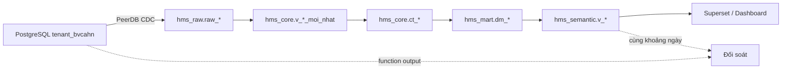

# Thiết kế ClickHouse Data Mart — đối soát tuyệt đối function PostgreSQL

**Trạng thái:** Đề xuất thiết kế, chưa triển khai DDL  
**Nguồn phân tích:** `docs/metric.md`, `dashboard_v2/docs/DDL.md`, `dashboard_v2/docs/function.md`  
**Nguyên tắc quyết định:** Kết quả function PostgreSQL hiện có là chuẩn tuyệt đối cho phase đối soát.

## 1. Mục tiêu và phạm vi

ClickHouse không nhận kết quả aggregate của PostgreSQL function làm nguồn dữ liệu. Thay vào đó, ClickHouse nhận CDC các bảng nghiệp vụ mà function dùng, tái hiện đúng joins, filters, thời gian nghiệp vụ và aggregate để:

1. Dashboard không tạo tải aggregate lên PostgreSQL OLTP.
2. Mọi kết quả ClickHouse có thể đối chiếu trực tiếp với function PostgreSQL cùng khoảng ngày.
3. Dashboard có thể mở rộng filter cơ sở/khoa sau khi có quy tắc attribution được phê duyệt.
4. UPDATE/DELETE CDC không tạo count/sum trùng.

### 1.1 Trong phạm vi phase đối soát

- 11 KPI trong `fn_dashboard_summary`.
- Doanh thu theo nguồn thu.
- Phân tích giới tính và loại người bệnh.
- `fn_dashboard_icd10_analytics`.
- Hai overload `fn_dashboard_icd10_stats`.
- `fn_dashboard_thong_ke_ngay`.

### 1.2 Ngoài phạm vi phase đối soát

`metric.md` yêu cầu công suất giường, ngày điều trị trung bình, tử vong nội trú, giá trị đơn thuốc và cảnh báo. DDL có các cột/bảng liên quan, nhưng `function.md` chưa có function định nghĩa nghiệp vụ tương ứng. Các metric này là **phase mở rộng**; không được tự suy diễn thành KPI chính thức trước khi có function hoặc xác nhận nghiệp vụ.

## 2. Nguyên tắc tương thích PostgreSQL

| Quy tắc | Áp dụng trong ClickHouse |
|---|---|
| Time window | Luôn dùng `[từ ngày 00:00, đến ngày + 1 00:00)`, đúng function nguồn |
| `bi_xoa` | Chỉ áp dụng khi function áp dụng; không thêm filter “cho sạch dữ liệu” |
| CDC DELETE | `FINAL` + `_peerdb_is_deleted = 0` ở latest-state layer |
| Soft delete | Giữ đúng điều kiện `COALESCE(bi_xoa::text, '0') IN ('0','false','f')` của `fn_dashboard_count_base` |
| DISTINCT | Giữ `count(DISTINCT ...)`, không thay bằng `count()` hay approximate distinct |
| `UNION ALL` | ICD-10 giữ nguyên hai nguồn BHYT/VIEN_PHI và không tự dedupe chéo nguồn |
| Previous period | `fn_dashboard_summary` chỉ có `p_*` khi chọn đúng một ngày; không mở rộng ngầm sang khoảng ngày |

## 3. Kiến trúc dữ liệu



### 3.1 Naming convention

Tên vật lý dùng ASCII không dấu để tránh vấn đề identifier/tooling:

| Prefix | Ý nghĩa | Ví dụ |
|---|---|---|
| `raw_` | bảng CDC từ PostgreSQL | `raw_tiep_nhan` |
| `v_` | latest-state hoặc semantic view | `v_tiep_nhan_moi_nhat` |
| `ct_` | bảng chi tiết chuẩn hóa, một grain nghiệp vụ | `ct_doanh_thu` |
| `dm_` | data mart aggregate | `dm_chi_so_dashboard_ngay` |
| `d_` | dimension/reference | `d_icd10` |

### 3.2 Engine và refresh strategy

| Layer | Engine/cơ chế | Lý do |
|---|---|---|
| `raw_*` | PeerDB + `ReplacingMergeTree(_peerdb_version)` | Nhận version INSERT/UPDATE/DELETE từ CDC |
| `v_*_moi_nhat` | View với `FINAL` và tombstone filter | Correctness trước background merge |
| `ct_*` | Refreshable MV → `MergeTree` | JOIN mutable nhiều bảng, có thể sửa lịch sử |
| `dm_*` additive | Refreshable MV → `MergeTree` | Recompute kết quả đúng khi source UPDATE/DELETE |
| `dm_*` distinct | Refreshable MV → `AggregatingMergeTree` | Giữ `uniqExactState` để merge chính xác qua nhiều ngày |

Không dùng Incremental Materialized View để cộng trực tiếp các bảng CDC mutable. UPDATE tạo version mới nhưng không tự đảo count/sum của version cũ.

## 4. Bảng nguồn cần CDC

### 4.1 Luồng tiếp nhận và điều trị

| Bảng PostgreSQL | Vai trò |
|---|---|
| `tiep_nhan` | tiếp nhận; thời điểm `ngay_tiep_nhan`; lý do tiếp nhận; cơ sở/khoa |
| `benh_nhan_tiep_nhan` | snapshot giới tính/ngày sinh theo lần tiếp nhận |
| `benh_nhan_dot_dieu_tri` | BHYT, quyền lợi, đối tượng điều trị |
| `kb_kham_benh` | lượt khám, `thoi_gian_bat_dau`, trạng thái hủy |
| `kb_kham_benh_chuyen_vien` | chuyển viện, `ngay_lap` |
| `csyt_benh_an_dieu_tri` | vào viện; dữ liệu nội trú mở rộng |
| `csyt_phieu_ra_vien` | ra viện, `thoi_gian_ra_vien` |

### 4.2 Dịch vụ, thuốc và doanh thu

| Bảng PostgreSQL | Vai trò |
|---|---|
| `phieu_dich_vu_chi_tiet` | chỉ định dịch vụ, `ngay_chi_dinh` |
| `csyt_yl_thuocvt` | chi tiết thuốc/vật tư; cặp đơn thuốc |
| `csyt_vien_phi_chung_tu` | chứng từ thu; trạng thái thanh toán và `ngay_thu` |
| `csyt_vien_phi_chung_tu_chi_tiet` | dòng doanh thu, tiền bệnh nhân trả |
| `dm_so_thu_hoa_don` | loại sổ hóa đơn `SBL` |
| `dmc_ma_nhom_chi_phi` | nhãn nguồn thu |

### 4.3 Xác nhận chi phí và ICD-10

| Bảng PostgreSQL | Vai trò |
|---|---|
| `csyt_xac_nhan_chi_phi` | nguồn BHYT, XML, ICD-10 |
| `csyt_xac_nhan_chi_phi_vien_phi` | nguồn viện phí, ICD-10 |
| `dmc_icd10` | danh mục mã/tên/nhóm ICD-10 |
| `dm_nhom_icd10` | nhóm ICD-10/chương |
| `dm_chuong_icd10` | chương ICD-10 |
| `dmc_doi_tuong_kcb` | nhãn đối tượng KCB |

## 5. Canonical tables (`ct_*`)

| Bảng | Grain | Bảng nguồn | Quy tắc function cần giữ |
|---|---|---|---|
| `ct_tiep_nhan` | 1 `tiep_nhan.id` | tiếp nhận, BN-tiếp nhận, đợt điều trị | emergency nếu lý do `02` hoặc có `ma_doi_tuong_lt='2'` |
| `ct_kham_benh` | 1 `kb_kham_benh.id` | khám bệnh | `bi_xoa=0`, `ghi_nhan_huy=0`, `so_phieu_to_dieu_tri IS NULL` |
| `ct_noi_tru` | 1 `csyt_benh_an_dieu_tri.id` | bệnh án điều trị | dùng `ngay_vao_vien`; generic soft-delete filter |
| `ct_ra_vien` | 1 `csyt_phieu_ra_vien.id` | phiếu ra viện | dùng `thoi_gian_ra_vien`; generic soft-delete filter |
| `ct_chuyen_vien` | 1 `kb_kham_benh_chuyen_vien.id` | chuyển viện | dùng `ngay_lap`; generic soft-delete filter |
| `ct_chi_dinh_dich_vu` | 1 `phieu_dich_vu_chi_tiet.id` | chi tiết dịch vụ | `bi_xoa=0`, `is_ksk=0`, `goi_dich_vu_id IS NULL` |
| `ct_don_thuoc` | 1 `csyt_yl_thuocvt.id` | y lệnh thuốc/vật tư | function chỉ nhận row có `khambenh_id`, `mauhososohoa_id` khác null |
| `ct_doanh_thu` | 1 chi tiết chứng từ viện phí | chứng từ, chi tiết, sổ, nhóm chi phí | chỉ chứng từ đã thanh toán, không hoàn/hủy, sổ `SBL` |
| `ct_xac_nhan_chi_phi` | 1 source confirmation row | BHYT hoặc viện phí | `bi_xoa=0`; có cờ `xuat_xml` |
| `ct_icd10_kcb` | 1 source confirmation row × 1 mã ICD | hai nguồn xác nhận + ICD dimensions | source/type được giữ để tái hiện `UNION ALL` |

### 5.1 `ct_tiep_nhan`

Giữ cả `ma_gioi_tinh_tn`, `is_bhyt`, `ma_quyen_loi`, `ma_doi_tuong_lt`, `ma_ly_do_tiep_nhan`, `ma_cskcb`, `ma_khoa_tiep_nhan`, `ngay_tiep_nhan`.

Không chuẩn hóa một mapping giới tính dùng chung ở canonical layer vì function nguồn mâu thuẫn:

- `fn_dashboard_patient_gender`: `2 → Nam`, `1 → Nữ`.
- `fn_dashboard_icd10_analytics`: `1 → Nam`, `2 → Nữ`.

Semantic layer của từng function phải áp dụng đúng mapping riêng đó.

### 5.2 `ct_doanh_thu`

Fields tối thiểu:

```text
id_chi_tiet_chung_tu, id_chung_tu, ngay_thu, ma_cskcb,
id_nhom_chi_phi, ma_nhom_chi_phi, nguon_thu,
tien_benh_nhan_cung_chi_tra, tien_benh_nhan_tu_thanh_toan,
so_tien_benh_nhan, da_thanh_toan, hoan_tra, huy_hoa_don, ma_loai_so
```

```text
so_tien_benh_nhan = thanh_tien_benh_nhan_cung_chi_tra
                   + thanh_tien_benh_nhan_tu_thanh_toan
```

`fn_dashboard_doanh_thu_nguon_thu` không lọc `bi_xoa` ở header/detail/dimension. Phase đối soát giữ nguyên hành vi này; phase cải tiến có thể bổ sung metric “doanh thu hợp lệ” khác tên.

### 5.3 `ct_icd10_kcb`

Fields tối thiểu:

```text
loai_thanh_toan, id_nguon, ngay_ra, ma_lk, benh_nhan_id,
ma_icd10, la_benh_chinh,
ma_nhom_icd10, ten_nhom_icd10,
ma_chuong_icd10, ten_chuong_icd10,
ngay_sinh, gioi_tinh, ma_doi_tuong_kcb
```

- `fn_dashboard_icd10_analytics` chỉ lọc `la_benh_chinh=1`.
- `fn_dashboard_icd10_stats` lấy cả mã bệnh chính và các mã bệnh kèm theo tách bằng `;`.
- Mỗi nguồn được giữ riêng bằng `loai_thanh_toan` (`BHYT`/`VIEN_PHI`); không dedupe giữa hai nguồn.
- Trong cùng một record nguồn, mã chính và mã kèm theo bị lặp chỉ được giữ một lần, đúng `SELECT DISTINCT` của function.

## 6. Data marts (`dm_*`)

### 6.1 `dm_chi_so_dashboard_ngay`

**Grain:** `ngay × ma_cskcb`.

| Measure | Function nguồn | Canonical source |
|---|---|---|
| `so_tiep_nhan` | `fn_dashboard_tiep_nhan` | `ct_tiep_nhan` |
| `so_cap_cuu` | `fn_dashboard_cap_cuu` | `ct_tiep_nhan` |
| `so_kham_benh` | `fn_dashboard_kham_benh` | `ct_kham_benh` |
| `so_vao_vien` | `fn_dashboard_vao_vien` | `ct_noi_tru` |
| `so_ra_vien` | `fn_dashboard_ra_vien` | `ct_ra_vien` |
| `so_chuyen_vien` | `fn_dashboard_chuyen_vien` | `ct_chuyen_vien` |
| `so_chi_dinh_dich_vu` | `fn_dashboard_chi_dinh_dich_vu` | `ct_chi_dinh_dich_vu` |
| `so_xac_nhan_chi_phi_bhyt` | `fn_dashboard_xac_nhan_chi_phi_bhyt` | `ct_xac_nhan_chi_phi` loại BHYT |
| `so_xuat_xml` | `fn_dashboard_xuat_xml` | `ct_xac_nhan_chi_phi` |

`fn_dashboard_summary` và `fn_dashboard_thong_ke_ngay` là semantic query trên mart này cộng với `dm_don_thuoc_ngay` và `dm_doanh_thu_nguon_thu_ngay`; không cần một bảng vật lý riêng cho summary.

### 6.2 `dm_don_thuoc_ngay`

**Grain:** `ngay_chi_dinh × ma_cskcb`.

Lưu `uniqExactState(tuple(khambenh_id, mauhososohoa_id))` thành `trang_thai_don_thuoc` trong `AggregatingMergeTree`. Khi query khoảng ngày, dùng `uniqExactMerge(trang_thai_don_thuoc)` để tái hiện chính xác:

```sql
count(DISTINCT (khambenh_id, mauhososohoa_id))
```

Không dùng `sum(so_don_ngay)`: cùng một cặp xuất hiện ở nhiều ngày sẽ bị đếm sai trên khoảng ngày.

### 6.3 `dm_doanh_thu_nguon_thu_ngay`

**Grain:** `ngay_thu × ma_cskcb × id_nhom_chi_phi`.

| Column | Ý nghĩa |
|---|---|
| `nguon_thu` | `COALESCE(ten_khac, '20. Khác')` |
| `so_dong_doanh_thu` | số detail lines hợp lệ theo function |
| `tong_doanh_thu_benh_nhan` | tổng phần cùng chi trả + tự thanh toán |

KPI `fn_dashboard_doanh_thu` là `sum(tong_doanh_thu_benh_nhan)`; bảng nguồn thu group theo `nguon_thu`.

### 6.4 `dm_tiep_nhan_gioi_tinh_ngay`

**Grain:** `ngay_tiep_nhan × ma_cskcb × nhom_gioi_tinh_fn`.

`nhom_gioi_tinh_fn` được derive theo riêng `fn_dashboard_patient_gender`: `2=Nam`, `1=Nữ`, còn lại `Chưa xác định`.

### 6.5 `dm_tiep_nhan_doi_tuong_ngay`

**Grain:** `ngay_tiep_nhan × ma_cskcb × nhom_doi_tuong_fn`.

| Nhóm | Điều kiện function nguồn |
|---|---|
| `CAN_BO_CAND` | `is_bhyt=1 AND ma_quyen_loi='5'` |
| `NGUOI_DAN` | BHYT quyền lợi `1..4` hoặc `is_bhyt=0` |

### 6.6 `dm_icd10_ngay`

**Grain:** `ngay_ra × loai_thanh_toan × ma_icd10`.

Lưu các aggregate states:

```text
countState()                         → trang_thai_so_ban_ghi
uniqExactState(ma_lk)                → trang_thai_luot_kcb
uniqExactState(benh_nhan_id)         → trang_thai_benh_nhan
```

Khi dashboard chọn nhiều ngày, dùng `countMerge`/`uniqExactMerge`; không cộng final count theo ngày. Dimension nhóm/chương ICD được giữ trong canonical fact để phục vụ `fn_dashboard_icd10_analytics` và `fn_dashboard_icd10_stats`.

## 7. Mapping function → semantic dataset

| Function | Semantic dataset ClickHouse | Cách tái hiện |
|---|---|---|
| `fn_dashboard_tiep_nhan` | `v_dashboard_tiep_nhan` | `sum(so_tiep_nhan)` |
| `fn_dashboard_cap_cuu` | `v_dashboard_cap_cuu` | `sum(so_cap_cuu)` |
| `fn_dashboard_kham_benh` | `v_dashboard_kham_benh` | `sum(so_kham_benh)` |
| `fn_dashboard_vao_vien` | `v_dashboard_vao_vien` | `sum(so_vao_vien)` |
| `fn_dashboard_ra_vien` | `v_dashboard_ra_vien` | `sum(so_ra_vien)` |
| `fn_dashboard_chuyen_vien` | `v_dashboard_chuyen_vien` | `sum(so_chuyen_vien)` |
| `fn_dashboard_chi_dinh_dich_vu` | `v_dashboard_chi_dinh_dich_vu` | `sum(so_chi_dinh_dich_vu)` |
| `fn_dashboard_don_thuoc` | `v_dashboard_don_thuoc` | `uniqExactMerge` state |
| `fn_dashboard_doanh_thu*` | `v_dashboard_doanh_thu*` | sum mart doanh thu theo ngày/nguồn |
| `fn_dashboard_patient_gender` | `v_dashboard_gioi_tinh` | aggregate mart giới tính function-specific |
| `fn_dashboard_patient_type` | `v_dashboard_doi_tuong` | aggregate mart đối tượng function-specific |
| `fn_dashboard_xac_nhan_chi_phi_bhyt` | `v_dashboard_xac_nhan_bhyt` | `sum(so_xac_nhan_chi_phi_bhyt)` |
| `fn_dashboard_xuat_xml` | `v_dashboard_xuat_xml` | `sum(so_xuat_xml)` |
| `fn_dashboard_icd10_analytics` | `v_dashboard_icd10_phan_tich` | filter ICD chính, group theo GROUP/MONTH/GENDER/AGE/CATEGORY |
| `fn_dashboard_icd10_stats(*)` | `v_dashboard_icd10_thong_ke` | merge states theo ICD/chương/nhóm/payment type |
| `fn_dashboard_summary` | `v_dashboard_tong_hop` | compose từ các semantic datasets |

## 8. Cơ sở và khoa/phòng

Function hiện chỉ nhận ngày, nên **tổng không filter** là baseline bắt buộc. `ma_cskcb` có sẵn ở phần lớn bảng nguồn và được đưa vào canonical/mart để hỗ trợ filter cơ sở, với điều kiện tổng các cơ sở phải bằng function gốc.

Khoa/phòng chưa có quy tắc thống nhất trong function:

- Tiếp nhận: `ma_khoa_tiep_nhan`, `ma_khoa_dieu_tri`, `ma_phong_tiep_nhan`.
- Khám: `ma_phong_ban`.
- Nội trú: `khoa_vao_id`, `khoa_ra_id`, lịch sử chuyển khoa.
- Doanh thu: `noi_thuc_hien_id`, `noi_chi_dinh_id`, hoặc header `noi_thu_id`.

Không áp một filter khoa/phòng chung trong phase đối soát. Phase mở rộng phải chọn một policy attribution cho từng metric và đối soát tổng trước/sau attribution.

## 9. Reconciliation

### 9.1 Chạy hằng ngày

Với mỗi ngày `D`:

1. Chạy `fn_dashboard_summary(D,D)` trên PostgreSQL.
2. Chạy `v_dashboard_tong_hop` trên ClickHouse với `[D,D]`.
3. So sánh từng `c_*`, `p_*`, doanh thu và thời điểm watermark.
4. Lưu kết quả vào `hms_ops.kiem_tra_doi_soat`.

### 9.2 Chạy theo các kiểm thử đặc biệt

- `fn_dashboard_doanh_thu_nguon_thu`: đối soát từng nguồn thu/ngày.
- `fn_dashboard_patient_gender`: đối soát từng bucket giới tính.
- `fn_dashboard_patient_type`: đối soát hai bucket.
- `fn_dashboard_icd10_analytics`: đối soát từng dimension type/value.
- `fn_dashboard_icd10_stats`: đối soát theo ICD, nhóm, chương và loại thanh toán.

Sai lệch tài chính là `0`; sai lệch count là `0`. Không publish dashboard chính thức khi CDC watermark chưa vượt thời điểm query hoặc có sai lệch.

## 10. Lộ trình triển khai

### Phase A — Raw và latest state

1. Mirror 19 bảng nguồn vào `hms_raw`.
2. Kiểm tra PK/replica identity cho từng bảng.
3. Bật PeerDB soft-delete và tạo `v_*_moi_nhat`.
4. Test INSERT, UPDATE `bi_xoa`, hard DELETE và retry CDC.

### Phase B — Canonical facts

1. Tạo toàn bộ `ct_*` tại phần 5 bằng Refreshable MVs.
2. Đối soát từng function đơn trước summary.
3. Chưa tạo filter khoa/phòng đa nguồn.

### Phase C — Daily marts và semantic layer

1. Tạo 6 `dm_*` tại phần 6.
2. Tạo `v_dashboard_*` tại phần 7.
3. Đối soát `fn_dashboard_summary` và ICD-10 trên ngày đơn/khoảng ngày.

### Phase D — Dashboard và extension

1. Kết nối Superset chỉ tới `hms_semantic`.
2. Hiển thị freshness watermark và trạng thái đối soát.
3. Thiết kế riêng metric công suất giường, LOS, tử vong và phân tích giá trị đơn thuốc sau khi có chuẩn nghiệp vụ/function.

## 11. Các phát hiện/rủi ro bắt buộc giữ lại

1. Hai function dùng mapping giới tính mâu thuẫn; không hợp nhất khi parity là mục tiêu.
2. `fn_dashboard_don_thuoc` không lọc `bi_xoa`; ClickHouse parity phải giữ như vậy.
3. Function doanh thu chỉ tính phần bệnh nhân cùng chi trả/tự trả; không phải toàn bộ tiền viện phí/BHYT.
4. Function doanh thu cũng không lọc `bi_xoa`; đây có thể là quyết định cũ hoặc lỗi, nhưng chưa được sửa trong phase parity.
5. `fn_dashboard_icd10_stats()` không tham số là thống kê toàn bộ lịch sử; overload có tham số là thống kê theo `ngay_ra`.
6. Các KPI trong `metric.md` không có function tương ứng chỉ được đánh dấu “mở rộng”, không dùng để phán định parity.
